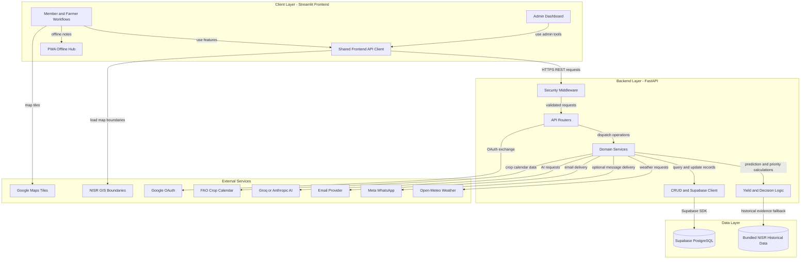
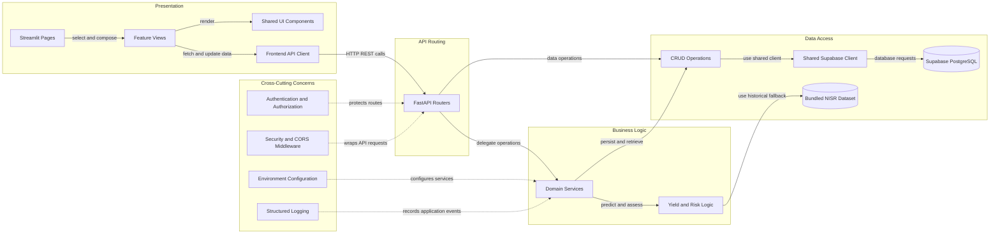

# Architecture Diagram

Agri-Menya separates its Streamlit client, FastAPI backend, and Supabase data store. The diagram follows member and administrator requests through backend security and API routing to application data and external integrations.

## Application Architecture

<!-- mermaid-checked: no \n, no em-dash/en-dash, no {} in labels, subgraphs are id["label"], arrows are -->|"label"|, all subgraphs closed by end, ids unique -->

### Technology Stack Summary

| Layer | Technology | Version | Purpose |
|---|---|---|---|
| Client | Streamlit and Python | Python 3.12 in Docker | Member, farmer, and admin workflows; maps, charts, and PWA entry points |
| API security and routing | FastAPI middleware and routers | Python 3.12 in Docker | Validate and dispatch HTTPS REST requests |
| Business logic | Python services and ML modules | See `backend/requirements.txt` | Recommendations, planning, yield and risk logic, and integrations |
| Data access | CRUD layer and Supabase client | Supabase Python SDK | Centralized application reads and writes |
| Persistence | Supabase PostgreSQL | Managed Supabase project | Zones, observations, plans, alerts, accounts, and imported NISR records |
| Deployment | Render or Docker Compose with Nginx | Service configuration | Separate hosted services or optional same-origin PWA gateway |

### Data Storage and External Services

Supabase PostgreSQL is the persistent application store, accessed by the backend through a shared Supabase client and CRUD layer. A bundled, provenance-tracked NISR dataset provides historical yield evidence when needed and remains separate from farmer field observations. NISR GIS services supply administrative boundaries; Open-Meteo supplies weather data. Google Maps and Google OAuth are used when configured. Optional integrations include Meta WhatsApp, email delivery, Groq or Anthropic AI providers, and the FAO crop-calendar API. WhatsApp defaults to mock mode unless live credentials and approved templates are configured.

### Key Architectural Decisions

- On Render, the browser calls the Streamlit app directly and Streamlit calls FastAPI over REST. In Docker Compose, Nginx can proxy the frontend and serve PWA assets at the same origin.
- The backend separates routers, domain services, ML logic, and database CRUD. A shared cached Supabase client centralizes database connectivity.
- Offline support is limited to the standalone PWA hub and cached static assets; live dashboards and backend workflows require a network connection.

## Component Relationships

<!-- mermaid-checked: no \n, no em-dash/en-dash, no {} in labels, subgraphs are id["label"], arrows are -->|"label"|, all subgraphs closed by end, ids unique -->

### Component Inventory

| Component | Layer | Type | Responsibility |
|---|---|---|---|
| Streamlit Pages | Presentation | Page entry points | Map user navigation to feature workflows |
| Feature Views | Presentation | UI orchestration | Render dashboard, zones, planning, decisions, communication, and administration |
| Shared UI Components | Presentation | Reusable components | Provide maps, charts, cards, navigation, and error boundaries |
| Frontend API Client | Presentation | HTTP client | Call backend endpoints and normalize responses for views |
| FastAPI Routers | API routing | REST controllers | Validate requests and dispatch operations to services or CRUD |
| Domain Services | Business logic | Application services | Implement planning, recommendation, messaging, weather, and community workflows |
| Yield and Risk Logic | Business logic | ML and domain modules | Calculate predictions, priorities, and risk-related outputs |
| CRUD Operations | Data access | Persistence functions | Read and write application records |
| Shared Supabase Client | Data access | Client factory | Provide cached access to Supabase |
| Supabase PostgreSQL | Data access | Managed database | Persist application records and NISR imports |
| Bundled NISR Dataset | Data access | Historical data artifact | Supply provenance-tracked historical yield evidence |
| Authentication and Authorization | Cross-cutting | Security services | Validate administrator and protected-operation access |
| Security and CORS Middleware | Cross-cutting | HTTP middleware | Apply host, origin, and response-header policies |
| Environment Configuration | Cross-cutting | Settings | Load and validate environment-specific configuration |
| Structured Logging | Cross-cutting | Observability | Record service lifecycle and operational failures |
