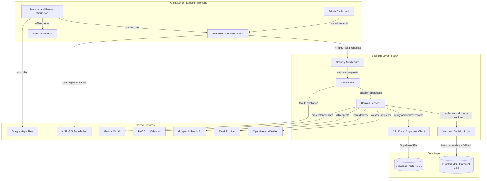

# Agri-Menya

### Practical agricultural insight, rooted in Rwanda.

Agri-Menya is an agricultural decision-support platform for exploring
district- and crop-level evidence, comparing zones, and planning field
activities. Its Streamlit interface works with a FastAPI service and Supabase;
yield estimates are grounded in validated National Institute of Statistics of
Rwanda (NISR) observations.

| Explore | Technology |
| --- | --- |
| [Open the live application](https://agrimenya-app-20261030.onrender.com/) | Streamlit · Python |
| [View the product walkthrough](https://drive.google.com/file/d/17Ko3W0DCiL7RJbVDtnvmJQp4RtiH60uL/view) | FastAPI · Supabase |

> **Walkthrough access:** Set the Google Drive file's General access to “Anyone
> with the link” if reviewers need to view it. The video at
> `frontend/assets/landing video.mp4` is a site asset, not the product demo.

## System architecture

The application separates its user interface, API, business logic, and
persistent data. Render hosts the frontend and API as separate web services;
Docker Compose can instead run both behind the optional Nginx PWA gateway.

<!-- mermaid-checked: no \n, no em-dash/en-dash, no {} in labels, subgraphs are id["label"], arrows are -->|"label"|, all subgraphs closed by end, ids unique -->


| Layer | Technology | Role |
|---|---|---|
| Client | Streamlit and Python | Member, farmer, and admin workflows; maps, charts, and PWA entry points |
| API security and routing | FastAPI middleware and routers | Validate and dispatch HTTPS REST requests |
| Business logic | Python services and ML modules | Recommendations, planning, yield and risk logic, and integrations |
| Data access | CRUD layer and Supabase client | Centralized application reads and writes |
| Persistence | Supabase PostgreSQL | Zones, observations, plans, alerts, accounts, and imported NISR records |
| Deployment | Render or Docker Compose with Nginx | Separate hosted services or optional same-origin PWA gateway |

Supabase is the persistent application store; the bundled NISR dataset provides
historical yield evidence when needed and remains separate from farmer field
observations. NISR GIS, Open-Meteo, Google Maps/OAuth, AI, and email integrations
are external services. Offline support covers the PWA hub and cached static
assets, not live dashboards or backend operations.

The frontend guides users through evidence, maps, recommendations, planning,
and field-reporting workflows. The floating bulb opens the agricultural AI
assistant. If the API is unavailable, the assistant can still display
historical NISR district-yield context from a bundled dataset; this offline
fallback is not an AI-generated answer, disease diagnosis, or zone-specific
action.

## Project map

```text
agrimenya/
├── frontend/                 Streamlit app and user-facing experience
│   ├── Home.py                App entry point
│   ├── pages/                 Streamlit page entry points
│   ├── views/                 Page-level workflows
│   ├── components/            Reusable UI, maps, charts, and widgets
│   ├── utils/                 API client, configuration, and shared helpers
│   ├── deployment/            Render startup and proxy configuration
│   └── data/                  Bundled offline NISR yield evidence
├── backend/
│   ├── app/
│   │   ├── main.py            FastAPI application
│   │   ├── routers/           HTTP endpoints
│   │   ├── services/          Application and provider integrations
│   │   ├── models/            API and domain models
│   │   ├── db/migrations/     Ordered Supabase schema changes
│   │   ├── ml/                Yield and decision-support logic
│   │   └── core/              Authentication, configuration, logging
│   ├── tests/                 Backend test suite
│   ├── scripts/               Admin, data, and evaluation utilities
│   ├── data/                  Source, training, and evaluation datasets
│   └── docs/                  Backend operations and technical guidance
├── data/                      Dataset inventory and source notes
├── docs/                      Product and repository guidance
├── demo/                      Product walkthrough notes
├── student_cards/             Safe placeholder; never store personal records
├── render.yaml                Render service definitions
├── docker-compose.yml         Root-level Compose configuration
└── README.md                  Setup and project guide
```

For detailed component relationships and responsibilities, see the
[architecture diagram](.github/modernize/assessment/engines/facts/architecture-diagram.md).
For frontend/API integration details, see
[`backend/docs/frontend_backend_handoff.md`](backend/docs/frontend_backend_handoff.md).
Dataset inventory and source notes are in [`data/README.md`](data/README.md).
Dependencies are kept separate for each service:
[`backend/requirements.txt`](backend/requirements.txt) for the API and
[`frontend/requirements.txt`](frontend/requirements.txt) for the app.

### Data and account safety

Reviewer administrator credentials are not published here. Share account
details only through an organizer-approved private channel, and use a
dedicated demo account rather than production administrator credentials.

The `student_cards/` folder is intentionally a safe placeholder. Do not commit
student cards or identity documents to this public repository. Submit only the
minimum required evidence through an approved private channel. If repository
submission is explicitly required, first confirm an approved restricted
repository and handling procedure.

## Quick navigation

- [Requirements](#requirements)
- [Team handoff](#team-b-handoff)
- [Run both services with Docker Compose](#run-both-services-with-docker-compose)
- [Production Docker deployment](#production-docker-deployment)
- [Local development without Docker](#local-development-without-docker)
- [Database setup](#database-setup)
- [Administrator access and recovery](#administrator-access-and-recovery)
- [NISR yield data](#nisr-yield-data)
- [Users and production readiness](#users-and-production-readiness)
- [Validation](#validation)

## Requirements

- Python 3.12 for the Docker images (Python 3.11 or newer for local
  development).
- Docker Desktop with Docker Compose, or separate Python environments for
  local development.
- A Supabase project with migrations applied. The backend needs the project
  URL and keys appropriate to the environment.

## Team B handoff

Use the shared feature branch so you receive the current backend, frontend,
database migrations, and yield evaluation data:

```powershell
git clone --branch feature/ci-logging-debug https://github.com/iiradukunda-dev/agrimenya.git
cd agrimenya/backend
Copy-Item .env.example .env
```

Fill `backend/.env` with `SUPABASE_URL` and `SUPABASE_SERVICE_ROLE_KEY` for the
project you are authorized to use. To see the same live records as Team A, both
teams need access to the same Supabase project; exchange its credentials
through an approved secure channel, never by committing `.env` to GitHub. Apply
migrations `0001` through `0018` if they are not already applied. Set
`JWT_SECRET` to a private random value of at least 32 characters for community
sessions. Then start both
services:

```powershell
docker compose up --build
```

Open the app at `http://localhost:8501` and the API health page at
`http://localhost:8000/health`. Live AI-provider behavior requires backend
credentials. The setup and local development instructions below cover
non-Docker options.

For a populated, isolated synthetic environment to explore the product, use
[`backend/docs/interactive_demo_data.md`](backend/docs/interactive_demo_data.md).
The demo seed is guarded, repeatable, and must only target a separate demo
Supabase project.

Never commit `.env` files, service-role keys, email/LLM provider credentials,
passwords, or local logs. The backend service-role key must stay in the
backend environment; do not copy it to Streamlit or the browser.

## Run both services with Docker Compose

Create `backend/.env` from the example and fill in at least the Supabase
settings. Run Compose from the `backend` directory so its `.env` file is used
for API settings and Compose variable interpolation:

```powershell
Copy-Item .env.example .env
# Edit .env and set the required Supabase values.
docker compose up --build
```

Open the frontend at `http://localhost:8501`; the API is available at
`http://localhost:8000`. Compose configures the frontend to call the API by its
internal service name. Stop the services with `Ctrl+C`, or run
`docker compose down` from `backend/`. View service status and logs with:

```powershell
docker compose ps
docker compose logs -f api frontend
```

### Production Docker deployment

Production uses a separate Compose stack with Caddy-managed HTTPS. From the
repository root, copy `backend/production.env.example` to
`backend/.env.production`, replace the example domains and secret placeholders,
point both DNS names at the Docker host, and ensure public ports 80 and 443 are
available. Then run:

```powershell
cd backend
docker compose --env-file .env.production -f docker-compose.production.yml config
docker compose --env-file .env.production -f docker-compose.production.yml up --build -d
docker compose --env-file .env.production -f docker-compose.production.yml ps
```

Only the HTTPS proxy publishes host ports; the API and frontend remain on the
private Compose network. See
[`backend/docs/production_deployment.md`](backend/docs/production_deployment.md)
for required secrets, Google OAuth setup, migrations, staging checks, and
remaining external-service launch gates. Do not deploy with the example
environment values.

Set `FRONTEND_PORT` in the Compose environment to change the host port. The
frontend image excludes local environments, secrets, logs, and editor files;
the backend build also excludes `.env` and offline datasets. Compose requires
the backend `.env` file to exist before startup.

## Local development without Docker

Create `backend/.env` from `backend/.env.example`, then set `SUPABASE_URL` and
`SUPABASE_KEY` (or `SUPABASE_SERVICE_ROLE_KEY`). The publishable key supports
only operations allowed by the database's RLS policies; server-side writes
need the service-role key. Do not put the service-role key in the frontend.

In PowerShell, install and run the API:

```powershell
cd backend
py -3.12 -m venv .venv
.\.venv\Scripts\Activate.ps1
python -m pip install -r requirements.txt
python -m uvicorn app.main:app --reload --host 127.0.0.1 --port 8000
```

In a second terminal, install and run Streamlit:

```powershell
cd frontend
py -3.12 -m venv .venv
.\.venv\Scripts\Activate.ps1
python -m pip install -r requirements.txt
Copy-Item .env.example .env
streamlit run Home.py --server.port 8501
```

The frontend `.env` defaults to `API_BASE_URL=http://localhost:8000`. Set its
`USER_API_KEY` to the same value as the backend when using protected user
operations. Restart the relevant service after changing environment values.

## Database setup

Apply the SQL files in `backend/app/db/migrations/` to Supabase in numeric
order, `0001` through `0018`, using the Supabase SQL editor or your migration
runner. Migrations `0005` and `0006` add contact, message tracking, consent,
and alert approval records; `0007` enables versioned NISR yield imports; and
`0008` adds named administrator accounts and password recovery tokens; `0009`
adds individually authenticated farmer discussions and moderation reports; `0010`
adds dated farmer field observations with optional private, compressed photos;
`0011` enforces unique lowercase community usernames.
`0014` adds action status history for saved plans. `0015` adds one-time
community email verification and shared API rate-limit storage. Existing
community accounts need to verify their email through the resend flow after
`0015` is applied. `0016` enables optional Google sign-in for Community.
`0017` adds named, separately mapped farm sites and optional farmer-drawn field outlines.
`0018` binds Google Community sign-in handoff codes to the browser that started
the OAuth flow.
Configure an email provider and the public Community URL before launch. Render
Free services block outbound SMTP ports, so use `EMAIL_PROVIDER=resend` with a
verified sending domain and a backend-only `RESEND_API_KEY`. Gmail SMTP requires
a paid Render service, `smtp.gmail.com` on port 587 with STARTTLS, matching
`EMAIL_FROM` and `SMTP_USER`, and a Google App Password (not the normal account
password).
These observations stay separate from official NISR yield records and are never
used as NISR baselines. Check
the migration comments and `backend/docs/` before applying these changes to a
production database.

After startup, check `http://localhost:8000/health`. For prediction readiness,
the database needs yield observations; the health endpoint reports whether
they are present. A healthy API connection alone does not mean yield data is
available.

## Administrator access and recovery

Apply migration `0008_admin_accounts.sql` and configure email delivery in
`backend/.env`. For production, set `ADMIN_PASSWORD_RESET_URL` to the public
HTTPS Admin page. Bootstrap the first named administrator from a trusted
backend shell:

```powershell
cd backend
python scripts/create_admin.py
```

The script prompts for a password without displaying it. Password recovery
uses a single-use link that expires after 30 minutes. If the recovery mailbox
is unavailable, an operator with trusted shell and database access can reset
the account with:

```powershell
python scripts/reset_admin_password.py admin@example.org
```

This invalidates existing administrator sessions. Do not configure the
service-role key in frontend settings. See
[`backend/docs/production_deployment.md`](backend/docs/production_deployment.md)
for production settings and administrator operations.

## NISR yield data

Administrators can import a normalized NISR CSV after migration `0007` is
applied. The required columns are `district`, `crop`, `season`, and positive
`yield_kg_ha`; optional columns are `production_mt` and `cultivated_area_ha`.
Review each release's source and mapped values before import. The server stages
and validates rows before activation; predictions read active database
observations rather than a few bundled CSV files. Import history and the full
format are documented in
[`backend/docs/nisr_imports_and_access.md`](backend/docs/nisr_imports_and_access.md).
The latest zone and yield provenance check, including limits on saved assessment
metadata and unverified coordinates, is recorded in
[`backend/docs/zone_data_provenance.md`](backend/docs/zone_data_provenance.md).

Training and evaluation are offline workflows. They may use source datasets
that are intentionally excluded from the runtime Docker image and should be
handled according to their source and access terms. See
[`backend/docs/retraining.md`](backend/docs/retraining.md) before creating
training artifacts.

## Users and production readiness

The frontend presents role-oriented experiences for citizens/farmers,
planners, cooperative leaders, and administrators. Administrator access uses
named accounts. Individual citizen/planner/cooperative accounts and complete
server-enforced ownership or membership scopes are still required before
those experiences can be treated as production access control; see the access
model in `backend/docs/nisr_imports_and_access.md`.

The optional farmer discussion pilot supports posts, comments, abuse reports,
and administrator moderation. Email verification is required at sign-in, while
farmer/organization roles remain self-reported. Farmer password recovery uses
a single-use email link. Satellite imagery is
currently removed because the reviewed public mosaic had limited, undated
coverage and did not support dependable crop monitoring. See
[`backend/docs/satellite_and_community.md`](backend/docs/satellite_and_community.md)
for data limitations and safeguards.

Keep provider credentials in the backend environment. Configure production
secrets, HTTPS origins, allowed hostnames, email recovery, and operational
backups as described in
[`backend/docs/production_deployment.md`](backend/docs/production_deployment.md).

## Validation

Run the backend suite from `backend/` after installing its requirements:

```powershell
python -m pytest tests -q
```

Docker image builds can be checked from `backend/` with:

```powershell
docker compose build
```
